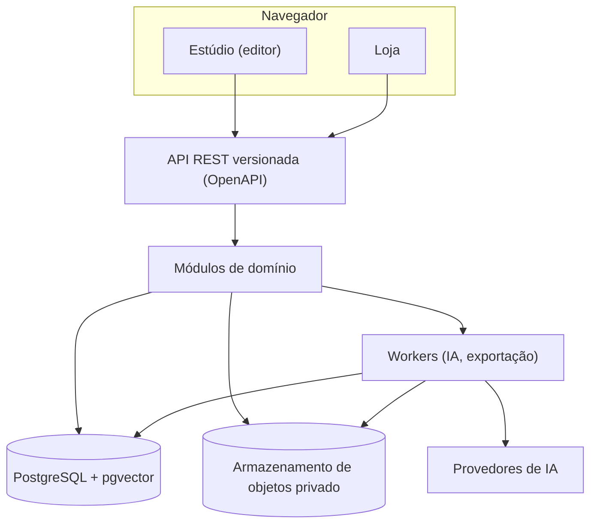

# Arquitetura

## Visão
Um **monólito modular** (Django + PostgreSQL), com workers assíncronos para tarefas pesadas e armazenamento de objetos privado. Módulos têm interfaces estáveis e podem virar serviços no futuro, se houver evidência de necessidade.

## Módulos e fronteiras
| Grupo | Módulos |
|---|---|
| Plataforma | identidade e papéis, auditoria, orçamento de IA |
| Criação | projetos, memória do projeto, ativos, personagens, orquestração, AI Gateway |
| Produção | livros e páginas em camadas, design, jogos digitais e físicos, qualidade |
| Comércio | catálogo, pedidos, pagamentos, downloads |

Dependências seguem um sentido só e são **impostas por teste automatizado** (contratos de importação). O teste foi verificado: ele falha quando uma violação é introduzida.

## Fluxo de geração com IA
1. O editor pede uma ilustração.
2. O sistema recupera o contexto do projeto (bíblia editorial, personagens, decisões anteriores).
3. Gera um plano e o valida: nenhum ativo aprovado pode ser tocado.
4. Estima o custo e pede aprovação se passar do limite.
5. O AI Gateway chama o provedor escolhido por política.
6. O resultado entra como **versão nova, em rascunho**, com proveniência completa.
7. Uma pessoa compara lado a lado e aprova ou pede revisão.

## AI Gateway
Expõe capacidades, não provedores. Cada adaptador declara o que suporta (referências, máscara, resolução), preço e a data em que foi verificado. A troca de provedor não exige mudar o domínio. Modelos e preços mudam com frequência, por isso a matriz de compatibilidade é mantida com data.

## Infraestrutura
Contêineres em desenvolvimento local; desenho compatível com nuvem (banco gerenciado, armazenamento de objetos, gerenciador de segredos). Nenhum recurso pago é criado sem aprovação.
